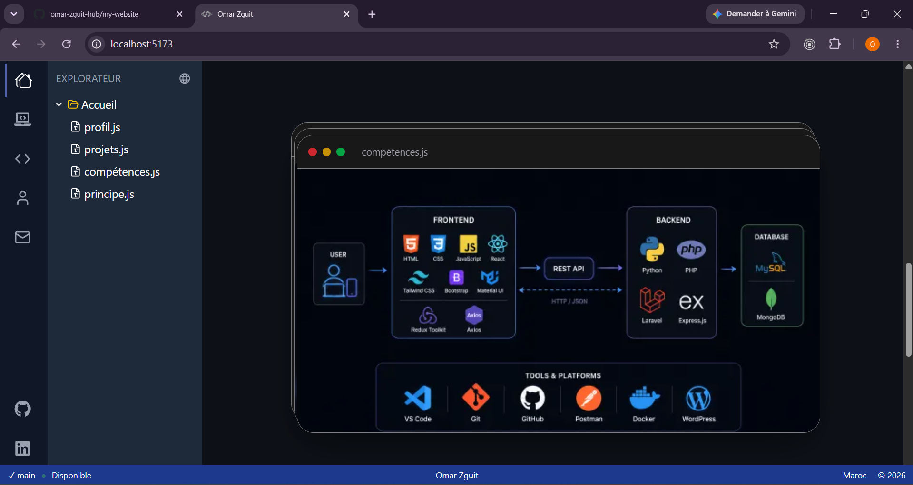
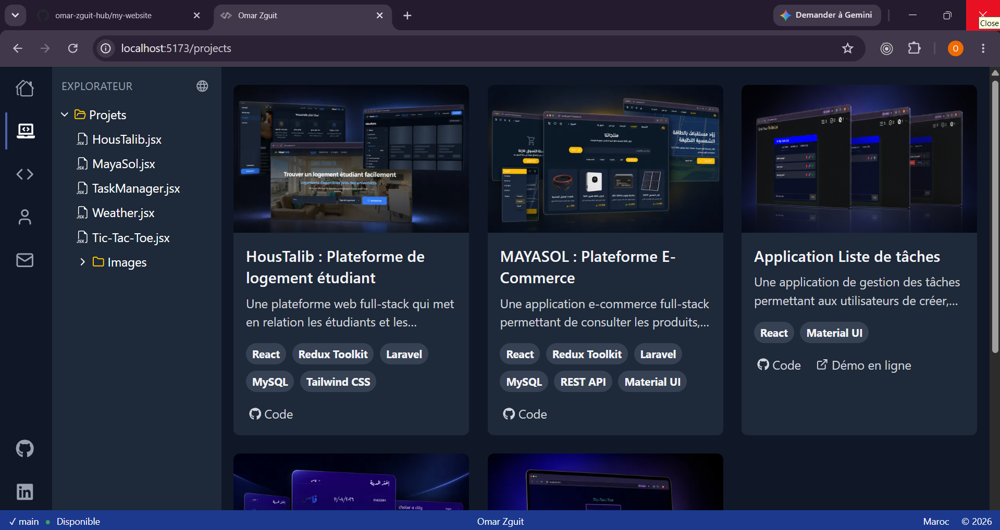
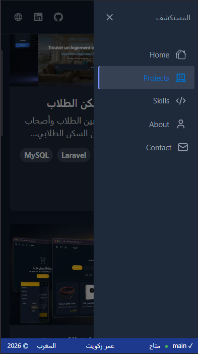

# Omar Zguit | Junior Full-Stack Web Developer


## About

My personal developer portfolio showcasing my skills, projects, experience, education, and contact information.

The design is inspired by modern code editors, with a responsive layout for desktop and mobile.

## Features

* Responsive design
* VS Code-inspired interface
* Projects showcase
* Skills and experience
* Contact form
* French & Arabic support
* RTL support
* CV download

## Tech Stack

* React.js
* React Router
* Tailwind CSS
* i18next
* Formspree
* Motion
* Lucide React
* React Icons

## Screenshots

<p align="center">
  
  
  
</p>

## Live Demo

[🌐 https://omarzguit.netlify.app](https://omarzguit.netlify.app)

## Installation

```bash
git clone https://github.com/omar-zguit-hub/my-website.git
cd omar-dev
npm install
npm run dev
```

## Author

**Omar Zguit**

* GitHub: [omar-zguit-hub](https://github.com/omar-zguit-hub)
* LinkedIn: [Omar Zguit](https://www.linkedin.com/in/omar-zguit-97377533a/)
* Portfolio: [Live Demo](https://omarzguit.netlify.app)
